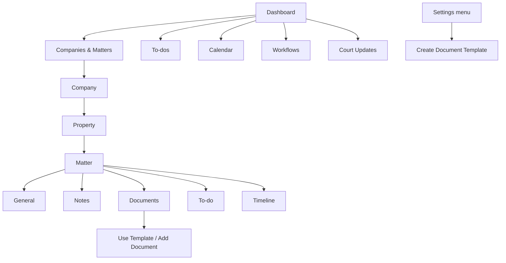

# Navigation hierarchy

Observed primary navigation: Dashboard, Clients, To-dos, Calendar, Billing, Workflows, Court Updates, Client Portal, Bulk Uploader, and Settings. Billing, Client Portal, and Bulk Uploader are not explored due to scope restrictions. `OBSERVED: RAD-E-0002, RAD-E-0010`.

Settings-menu destinations classified as restricted: Staff Management, Reports, Custom Fields, Email Templates, User Permissions, Backup/Export Data, Masters, Theme Settings. Create Document Template was inspected only as an unsaved form. `OBSERVED: RAD-E-0010, RAD-E-0011`.
