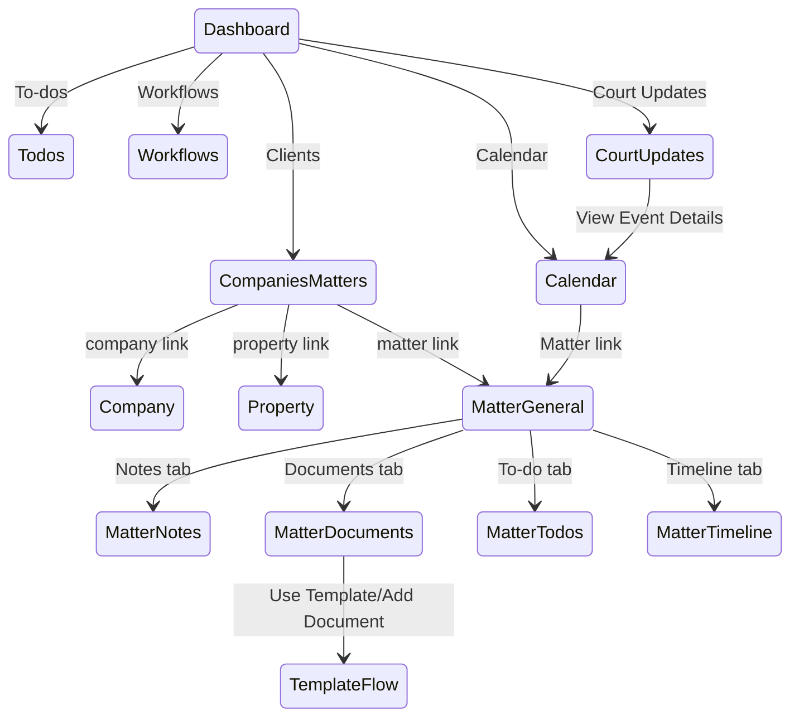

# Screen transition map

These are route-level transitions observed in the UI only. The TemplateFlow is intentionally not executed; it is a documented transition inferred from the visible link. `OBSERVED: RAD-E-0004, RAD-E-0006, RAD-E-0007, RAD-E-0008, RAD-E-0009`.
