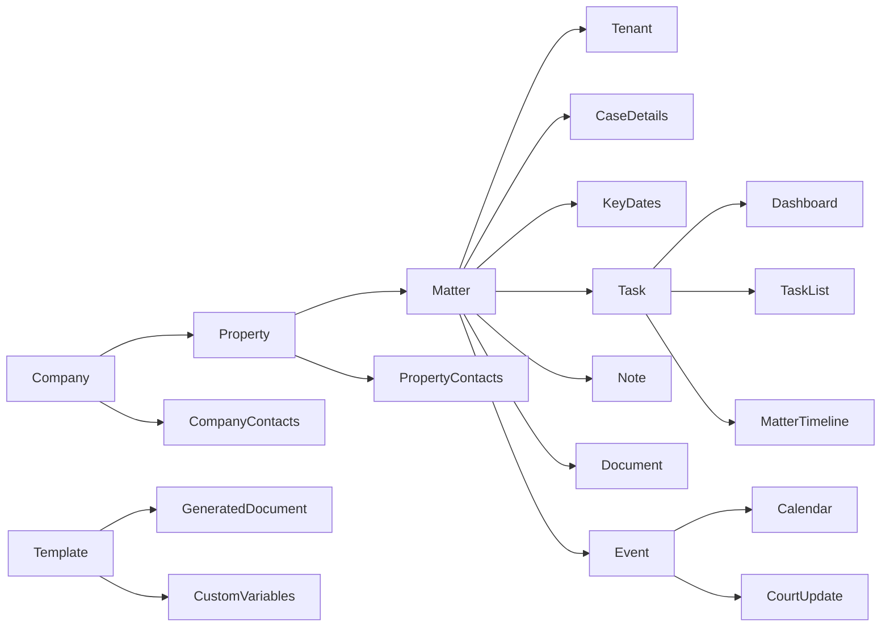

# Data lineage

Observed evidence confirms the hierarchy and visible consumers. It does not yet prove database cardinalities, cascade behavior, or dynamic-variable substitution. `OBSERVED: RAD-E-0002, RAD-E-0004 through RAD-E-0011`.

Client-confirmed cardinality: one Company may own multiple Properties, and one Property may own multiple Matters. Automation must create the parent once, then create each child through its explicit add path and verify the resulting Matter row contains the intended Company and Property. `CLIENT-CONFIRMED: 2026-10-23`.

Client-confirmed billing lineage, 2026-10-26: submitted Court Update → Court Time
→ auto-populated amount → saved Time entry → invoice workflow, with Expenses also
handled before invoicing. Source: direct client explanation; high reliability as
a requirement. Runtime propagation, field/rate source, amount calculation,
rounding, and invoice inclusion remain UNVERIFIED. Do not substitute independently
created Time entries for proof of the Court Time handoff.
