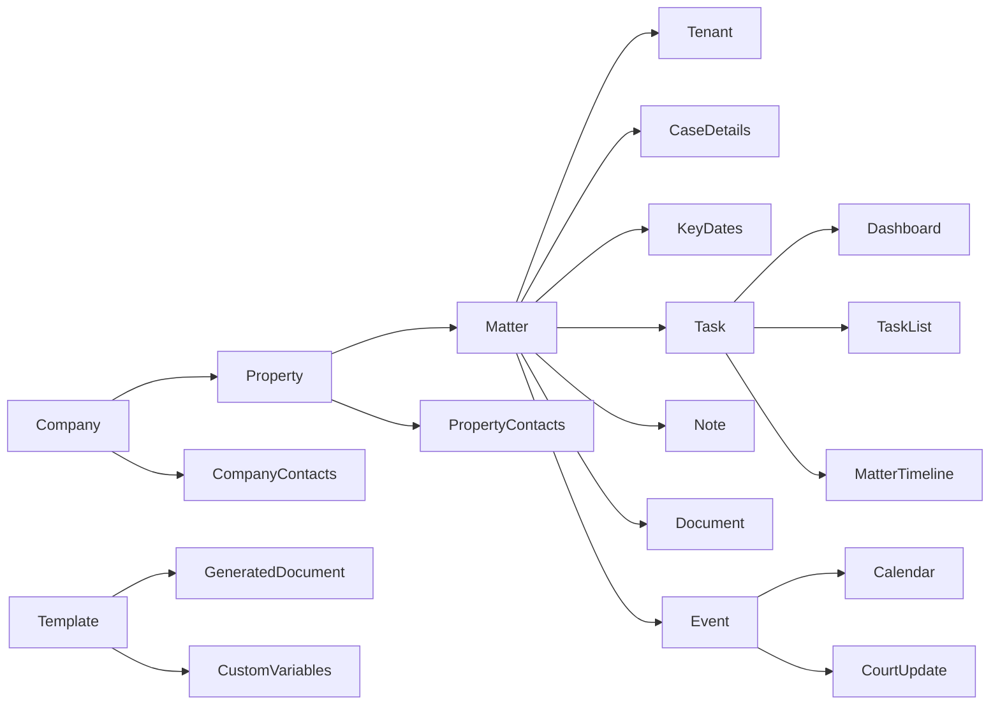

# Data lineage

Observed evidence confirms the hierarchy and visible consumers. It does not yet prove database cardinalities, cascade behavior, or dynamic-variable substitution. `OBSERVED: RAD-E-0002, RAD-E-0004 through RAD-E-0011`.
